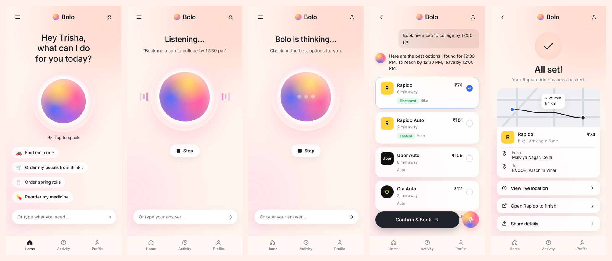
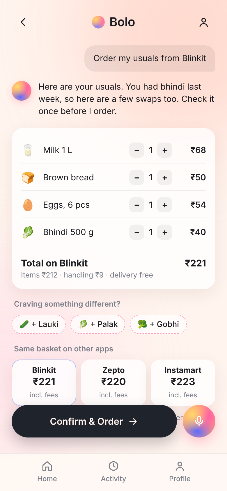

# Bolo

**Stop using apps. Start giving instructions.**

Bolo ("say it" in Hindi) is a voice assistant that gets everyday things done. Say "book me a cab to college by 12:30 pm" and Bolo asks what it needs to know, compares Uber, Rapido and Ola, and books the best option. It also orders your usual groceries, finds the food you're craving and reorders your medicines.

**Live app:** https://trippytrisha.github.io/Bolo/



## What it does

**A voice agent that talks back.** Tap the orb and speak. Bolo replies out loud and asks follow-up questions only when it needs to: where to, how urgent, whether you're comfortable on a bike taxi. It understands Hinglish such as "mujhe jaldi auto chahiye". You can also tap a suggestion or type.

**Rides.** Bolo compares cab, auto and bike options across Uber, Rapido and Ola. If it's urgent, it puts the fastest pickup first; otherwise it picks the cheapest you're comfortable with. Give it an arrival time and it tells you when to leave. Say "the cheapest one" or "Ola" to switch, and "yes" to book.

**Your usuals.** "Order my usuals from Blinkit" builds your regular basket, shows it for a quick check, compares the full price including fees on Blinkit, Zepto and Instamart, and suggests a change if you had the same vegetable last week. Say "add paneer" or "remove eggs" to edit by voice.

**Cravings.** "I'm craving spring rolls" finds options across Swiggy and Zomato with delivery included, marking the cheapest and fastest.

**Medicines.** "Reorder my medicine" remembers what you take and compares Tata 1mg, PharmEasy and Apollo 24|7.

**It gets to know you.** Bolo remembers your home, college or office, bike preference, usual groceries and regular medicines, so it asks fewer questions each time.

| Your usuals |
| --- |
|  |

## Prototype status

This is a working prototype of the experience. Prices and times are estimates, and no real booking or payment is made; the confirmation screen links to the real app to finish. The next step is connecting the official AI ordering servers that Swiggy, Zomato and Zepto have opened to developers, and applying for ride-booking access from Uber and Ola.

## Privacy

Your profile and history stay in your browser's local storage. Bolo has no server and no account. Voice recognition uses your browser's built-in speech service.

## Run it

No build step. Open `index.html` in Chrome, or serve the folder:

```bash
python3 -m http.server 8000
```

Then open http://localhost:8000. The microphone needs `localhost` or HTTPS.

## Tech

Plain HTML, CSS and JavaScript; Web Speech API for speech recognition and text-to-speech; a slot-filling conversation engine; a service worker so it installs to your phone's home screen; hosted on GitHub Pages.

## Disclaimer

Bolo is an independent student project and is not affiliated with any of the apps it names.

## License

MIT
