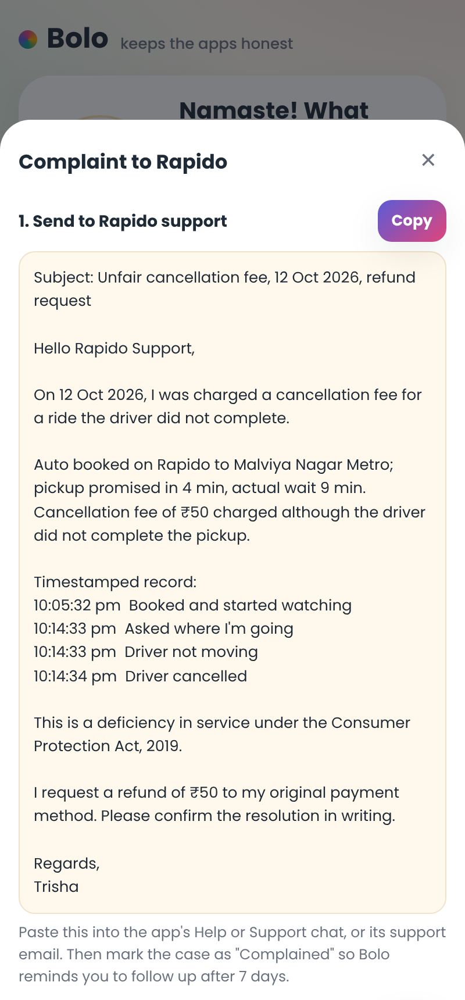
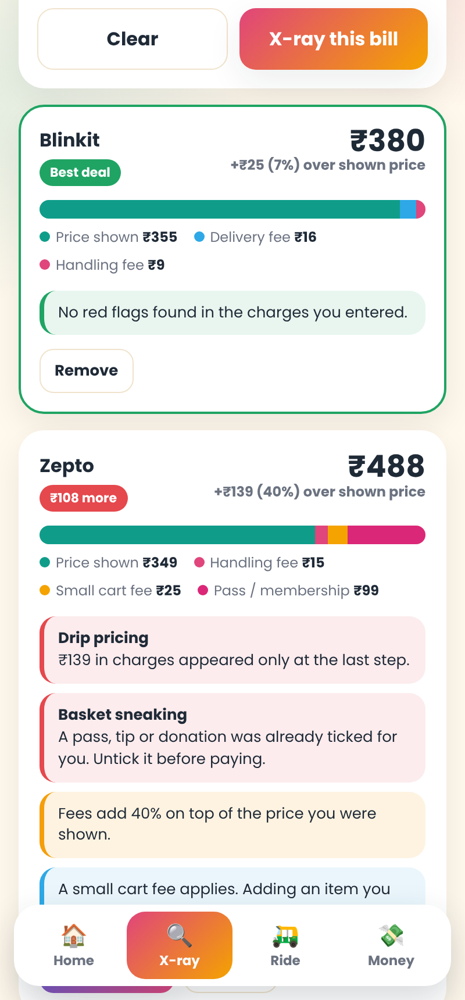
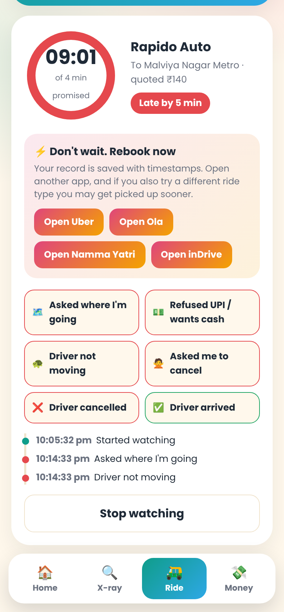
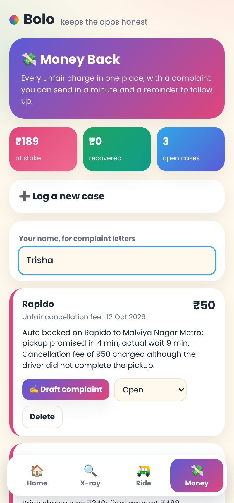
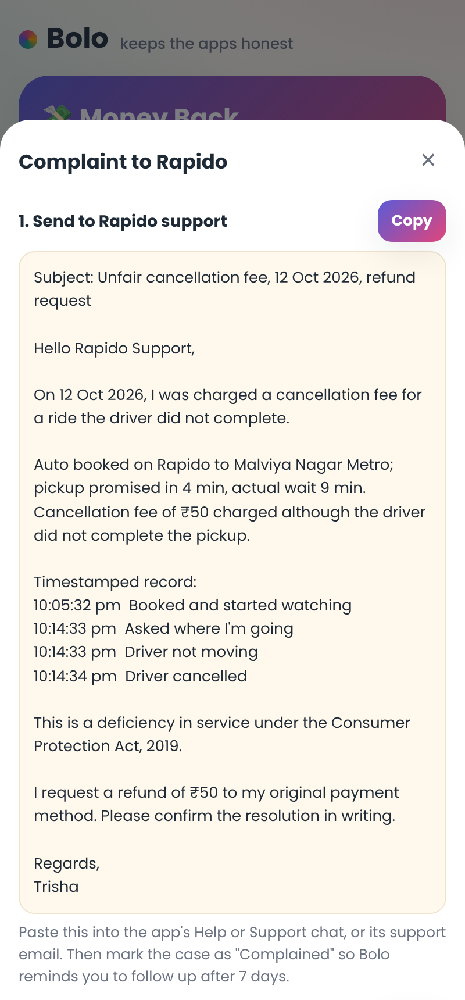

# Bolo 🛺💸

**Bolo keeps the apps honest.** See the true price before you pay, watch your ride as it happens, and get your money back when something goes wrong.

**Live app:** `https://<your-github-username>.github.io/bolo/`

| Home | Price X-ray | Ride Watch | Money Back | Complaint |
| --- | --- | --- | --- | --- |
|  |  |  |  |  |

## Why Bolo exists

Delivery and ride apps compete on the price they show first, and the friction shows up later. In a LocalCircles survey of over 94,000 app-taxi users ([Business Standard, Nov 2025](https://www.business-standard.com/india-news/cabs-ride-hailing-platforms-dark-pattern-hidden-charges-cancellations-125111101929_1.html)), 90% said they had to cancel because a driver or platform would not serve them, 86% saw a short wait turn into a long one, and 59% saw fees appear only at the end of the ride. In a LocalCircles survey of 32,000 food delivery users ([Outlook Business, Nov 2024](https://www.outlookbusiness.com/news/hidden-fees-affect-68-of-food-delivery-app-users-says-survey)), 68% reported hidden charges. The Central Consumer Protection Authority fined Zepto Rs 7 lakh in December 2025 for adding charges at the last step and pre-selecting a paid pass ([MediaNama](https://www.medianama.com/2025/12/223-zepto-fined-7-lakh-dark-patterns-ahead-ipo/)).

Platforms own everything up to the click. Bolo is on the user's side after it.

## Features

**🔍 Price X-ray.** Enter the price an app showed you and each charge added at checkout (or scan a checkout screenshot, beta). Bolo shows the true landed price, a colored breakdown of every fee, and flags practices named in the CCPA's Guidelines for Prevention and Regulation of Dark Patterns, 2023, such as drip pricing and basket sneaking. Add the same cart from another app and Bolo ranks them by what you would really pay.

**🛺 Ride Watch.** Start it the moment you book. Bolo times the pickup against the promised wait, lets you log what the driver does in one tap (asked your destination, refused UPI, stopped moving, asked you to cancel, cancelled), and keeps a timestamped record. When the driver stalls or runs late it offers one-tap rebooking on the other ride apps. At the end it checks the final fare against the quote and any cancellation fee.

**💸 Money Back.** Every unfair charge becomes a case with an amount, status and evidence. Bolo drafts a refund request to the app's support and an escalation for the National Consumer Helpline, with the right legal reference, and reminds you to follow up after seven days. Totals show how much is at stake and how much you have recovered.

**🎙️ Voice.** Tap the orb and say "check this bill", "my driver is late" or "refund chahiye" to jump to the right tool (Chrome recommended).

## Privacy

Everything stays on your phone in the browser's local storage. Bolo has no server, no account and no tracking. The screenshot reader loads an open-source text recognition library (Tesseract.js) and reads the image inside your browser.

## Run it

No build step. Open `index.html`, or serve the folder:

```bash
python3 -m http.server 8000
```

Then open http://localhost:8000. To publish, push to GitHub and turn on Pages (Settings → Pages → Deploy from branch → `main` / root).

## Roadmap

1. Better screenshot reading for the major apps' checkout layouts.
2. Live cross-app ride price comparison before booking.
3. Hindi interface and Hindi complaint drafts.
4. Refund tracking from order confirmation emails, with the user's permission.
5. Direct ordering through the official AI ordering servers opened by Swiggy, Zomato and Zepto.

## Tech

Plain HTML, CSS and JavaScript; Web Speech API for voice; Tesseract.js for on-device screenshot reading; service worker for offline use; hosted on GitHub Pages.

## Disclaimer

Bolo helps you organize evidence and draft complaints. It is not legal advice, and it is not affiliated with any of the apps it names.

## License

MIT
